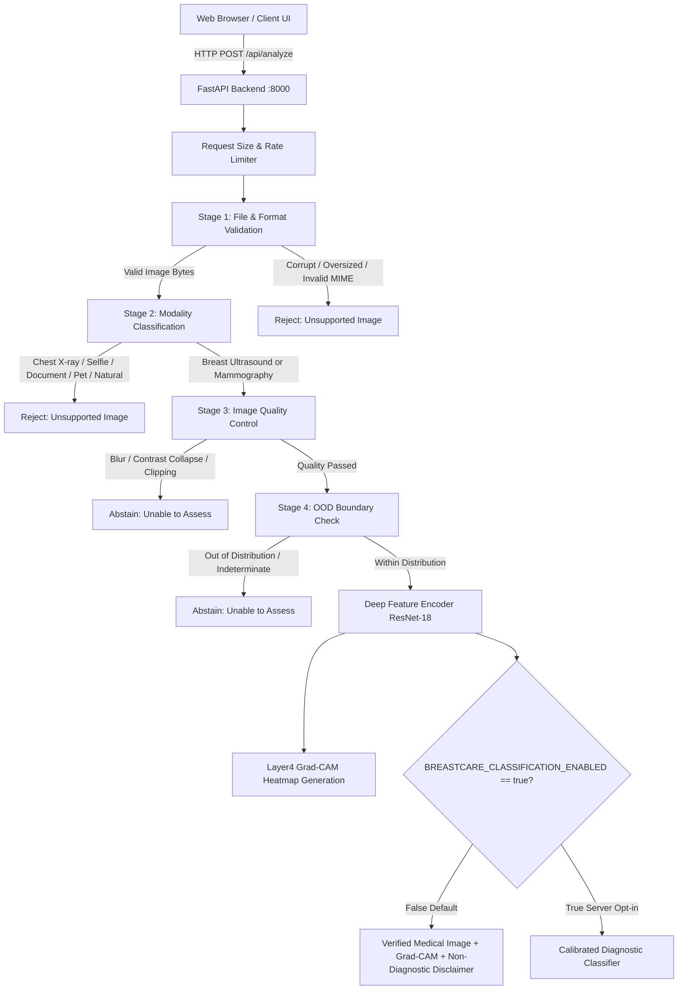

# System Architecture & Technical Specifications

**BreastCare AI** is an investigational medical decision-support research application engineered with strict clinical safety constraints, dual-modality validation, interpretability mechanisms, and a fail-closed architecture.

---

## 1. High-Level Architectural Diagram

---

## 2. Component Specifications

### 2.1 Backend (`backend/app`)
- **Framework:** FastAPI with Uvicorn ASGI server.
- **Python Environment:** Python 3.13 / PyTorch CPU.
- **Endpoints:**
  - `GET /health`: Liveness probe verifying server process status.
  - `GET /ready`: Readiness probe verifying configuration and model artifact status.
  - `GET /api/models`: Model registry metadata, performance summaries, and active limitations.
  - `POST /api/validate-image`: Ephemeral 4-stage validation without running deep inference.
  - `POST /api/analyze`: Full multi-stage pipeline, modality discrimination, Grad-CAM generation, and fail-closed research evaluation.
  - `GET /api/references`: Clinical guidelines and dataset provenance citations.
  - `GET /model-info` & `POST /analyze`: Legacy backwards-compatibility endpoints for prior test suites.

### 2.2 Frontend (`web/`)
- **Framework:** Next.js 15 (App Router) with React 19 and TypeScript.
- **Styling:** Tailwind CSS with the official Breast Cancer Pink Palette:
  - Primary Pink: `#D63384`
  - Soft Pink: `#FCE7F3`
  - Rose Pink: `#F9A8D4`
  - App Background: `#FFF7FB`
  - Slate Dark Text: `#334155`
  - Pure White: `#FFFFFF`
- **Pages (6 Dedicated Views):**
  1. `/` (Home): Brand hero, clinical protocol state, awareness ribbon branding, and feature grid.
  2. `/analyze` (AI Analysis): Multi-stage file upload, real-time validation progress, Grad-CAM toggle, research report download.
  3. `/cancer-info`: Comprehensive pathophysiology, benign vs malignant distinction, signs, and screening guidelines.
  4. `/treatment-info`: Clinical treatment pathways (Surgery, Radiotherapy, Chemotherapy, Hormonal, HER2-targeted, Immunotherapy) citing NCI PDQ, ACR BI-RADS, ASCO, ESMO, and NCCN.
  5. `/model-evidence`: Dataset provenance, architectures, cross-validation metrics, and documented failure modes.
  6. `/about`: Project mission, ethical governance, and legal safety disclaimers.

---

## 3. Four-Stage Validation Pipeline

1. **Stage 1 (File Integrity):** Validates MIME types (`image/jpeg`, `image/png`), payload limits (<=10MB), dimensions (>=64x64, <=4096x4096), and successful Pillow byte decoding.
2. **Stage 2 (Modality Detection):** Evaluates grayscale entropy, color saturation ratios, aspect ratios, air-margin margins, and bilateral lung column structures to distinguish Breast Ultrasound vs Mammography vs Chest X-rays vs Non-Medical imagery.
3. **Stage 3 (Quality Screening):** Computes Laplacian variance (blur threshold >= 15.0), dynamic range / standard deviation (>= 12.0), and clipping checks.
4. **Stage 4 (OOD Assessment):** Computes texture uniformity, peripheral frame boundary darkness, and feature density to detect out-of-distribution scans.

---

## 4. Privacy & Data Handling
- **Zero Disk Retention:** Uploaded image bytes are processed ephemerally in RAM and never written to permanent disk or third-party storage.
- **Fail-Closed Default:** Primary classification is disabled (`BREASTCARE_CLASSIFICATION_ENABLED=false`) until multi-center prospective trial approval.

